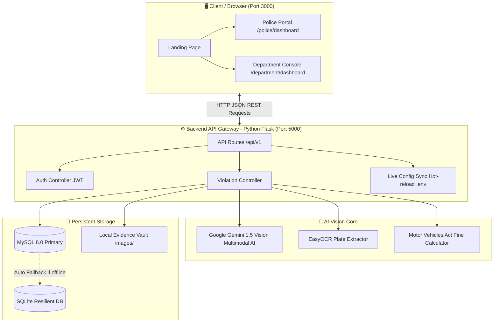

# 🏛️ AI Traffic Analytics & Enforcement Platform - System Architecture

> **👋 Welcome, Beginner!**  
> If you are new to web development, AI, or system architecture, don't worry! This guide is written specifically for you. We explain how every part of this project works using simple words, real-world analogies, visual diagrams, and a file-by-file directory map.

---

## 📚 Table of Contents
1. [The Big Picture: What Does This Project Do?](#1-the-big-picture-what-does-this-project-do)
2. [The "Restaurant" Analogy (How Everything Connects)](#2-the-restaurant-analogy-how-everything-connects)
3. [Visual Architecture Diagram](#3-visual-architecture-diagram)
4. [The 4 Core Layers Explained Simply](#4-the-4-core-layers-explained-simply)
   - [Layer 1: Frontend (The Visual Experience)](#layer-1-frontend-the-visual-experience)
   - [Layer 2: Backend API (The Brain & Traffic Director)](#layer-2-backend-api-the-brain--traffic-director)
   - [Layer 3: AI Engine (The Smart Detective)](#layer-3-ai-engine-the-smart-detective)
   - [Layer 4: Database & Storage (The Permanent Memory)](#layer-4-database--storage-the-permanent-memory)
5. [Step-by-Step: The Journey of a Traffic Snapshot](#5-step-by-step-the-journey-of-a-traffic-snapshot)
6. [Complete Project Folder & File Guide](#6-complete-project-folder--file-guide)
7. [Summary Checklist for Beginners](#7-summary-checklist-for-beginners)

---

## 1. The Big Picture: What Does This Project Do?

In modern cities, thousands of vehicles pass traffic intersections every minute. Human police officers cannot watch every vehicle at once. 

**This project is an automated AI traffic police system:**
1. A traffic camera captures a photo or video snapshot of a vehicle.
2. The system sends the photo to **Artificial Intelligence (AI)**.
3. The AI inspects the photo and answers two questions:
   - *Is there a violation?* (e.g. Riding without a helmet? Three people on a bike? Driving without a seatbelt? Using a phone?)
   - *What is the vehicle's registration number?* (Reads Indian number plates like `KA 02 HV 6226`).
4. The system calculates the legal fine based on the **Indian Motor Vehicles Act (MVA)**.
5. It generates an official **e-Challan (digital ticket)** and saves the photo as legal evidence in a database.
6. Police officers and city administrators can view, search, and manage all violations on interactive web dashboards.

---

## 2. The "Restaurant" Analogy (How Everything Connects)

If terms like *Client*, *Server*, *API*, and *Database* sound confusing, think of this project like a **Restaurant**:

| Project Component | Technical Term | Restaurant Equivalent | What It Does In Plain Words |
| :--- | :--- | :--- | :--- |
| **User's Browser (React UI)** | **Frontend / Client** | 🍽️ **The Dining Table & Menu** | The nice screen you look at, click buttons on, and upload photos to. It makes everything look beautiful. |
| **Python Flask Server** | **Backend / REST API** | 🤵 **The Waiter** | Takes your photo from the screen, brings it to the kitchen, and brings back the results to show you. |
| **Google Gemini & EasyOCR** | **AI Engine** | 👨‍🍳 **The Master Chef** | Inspects the ingredients (the image pixels), finds violations, and reads the plate text. |
| **MySQL / SQLite Database** | **Database / Persistence** | 📖 **The Order Ledger / Pantry** | Safely writes down every ticket issued so nothing is lost, even if you close your computer. |

---

## 3. Visual Architecture Diagram

Here is a visual map showing how data travels through the system:



---

## 4. The 4 Core Layers Explained Simply

### Layer 1: Frontend (The Visual Experience)
- **Built with:** [React 18](https://react.dev/) + [Vite](https://vitejs.dev/)
- **Where it lives:** The `frontend/` folder.
- **Port:** Runs on `http://localhost:3000`.
- **What it does:**
  - Provides a modern dark-mode surveillance interface with glowing neon badges, radar grids, and responsive layouts.
  - **Police Portal:** Allows on-duty officers to upload traffic camera photos, review AI findings, and issue tickets in 1 click.
  - **Department Portal:** Allows administrators to view violation trends, search past records, and update the AI API key.
- **Why React + Vite?** Vite starts up instantly (in milliseconds), and React lets us build smooth interactive pages without reloading the web browser every time you click a button.

---

### Layer 2: Backend API (The Brain & Traffic Director)
- **Built with:** [Python 3.10+](https://www.python.org/) + [Flask](https://flask.palletsprojects.com/)
- **Where it lives:** The `backend/` folder.
- **Port:** Runs on `http://localhost:5000`.
- **What it does:**
  - Serves as the **API Gateway** (Application Programming Interface).
  - Listens for requests from the frontend (like *"Hey, here is a photo, please analyze it!"*).
  - Handles security (checks passwords and generates secure JWT login tokens).
  - **Hot-Reloading Feature:** Allows administrators to paste a new Gemini AI API key into the web settings modal. The backend immediately updates `.env` files in memory without needing to restart the server!

---

### Layer 3: AI Engine (The Smart Detective)
- **Built with:** [Google Gemini 1.5 Vision](https://ai.google.dev/) + [EasyOCR](https://github.com/JaidedAI/EasyOCR) + Python OpenCV
- **Where it lives:** The `ai_engine/` folder.
- **What it does:**
  - **Multimodal Visual Reasoning:** Sends the photo to Google's Gemini Vision model with a specialized prompt. The AI identifies:
    - Triple riding (more than 2 people on a motorbike/scooter).
    - Missing helmets on riders or passengers.
    - Drivers not wearing seatbelts.
    - Drivers holding mobile phones while driving.
    - Red light jumping and wrong-way driving.
  - **License Plate Extraction (ANPR):** Reads the vehicle registration number. It handles both single-line plates (`DL 01 AB 1234`) and tricky two-line stacked Indian motorcycle plates (`KA 02` on top and `HV 6226` below) by merging them into one clean format.
  - **Statutory Law Matcher:** Automatically assigns the official Indian legal penalty (e.g. *Section 129/194D - ₹1,000 fine for No Helmet*).

---

### Layer 4: Database & Storage (The Permanent Memory)
- **Built with:** [SQLAlchemy ORM](https://www.sqlalchemy.org/) + MySQL 8.0 + SQLite
- **Where it lives:** `backend/storage/`
- **What it does:**
  - Stores all challan records, timestamps, vehicle numbers, officer details, and fine amounts.
  - **Auto-Failover Resiliency:** If you have MySQL installed and running, it connects to MySQL. If MySQL is turned off or not installed on your laptop, **the system never crashes!** It automatically switches to an embedded SQLite database (`database.sqlite`) seamlessly.
  - Evidence images are saved with unique timestamped filenames so they can be shown in court if a driver disputes a ticket.

---

## 5. Step-by-Step: The Journey of a Traffic Snapshot

Here is what happens behind the scenes in under 3 seconds when an officer clicks **"Scan & Analyze"**:

```
[1] Officer uploads photo in Web Browser
         │
         ▼
[2] React sends HTTP POST /api/v1/violations/analyze with the image file
         │
         ▼
[3] Flask receives image, saves a copy to the evidence archive
         │
         ▼
[4] Flask calls AI Engine:
    ├── Step 4A: Gemini Vision scans image for physical violations
    ├── Step 4B: EasyOCR scans license plate bounding box
    └── Step 4C: MVA rules engine calculates statutory fine
         │
         ▼
[5] Flask writes the violation & challan into the Database (MySQL or SQLite)
         │
         ▼
[6] Flask sends back JSON data to the Frontend:
    {
      "plate_number": "KA 02 HV 6226",
      "violations": ["NO_HELMET", "TRIPLE_RIDING"],
      "total_fine": 2000,
      "challan_id": "CH-2026-98124"
    }
         │
         ▼
[7] React updates the screen with glowing violation tags, vehicle number, and e-Challan receipt!
```

---

## 6. Complete Project Folder & File Guide

Here is an easy map of every important folder and file in this repository:

```
AI-Traffic-Analytics/
│
├── frontend/                     # 🌐 EVERYTHING YOU SEE IN THE BROWSER
│   ├── src/
│   │   ├── components/           # Reusable UI parts (Navbar, Badges, Modals)
│   │   ├── pages/                # Main web pages:
│   │   │   ├── Landing.jsx       # Public homepage
│   │   │   ├── PoliceDashboard.jsx # Officer enforcement terminal
│   │   │   └── DepartmentDashboard.jsx # Admin management console
│   │   ├── App.jsx               # Main React application & route switcher
│   │   └── index.css             # Styling, colors, neon effects, dark mode
│   ├── vite.config.js            # Vite configuration (port 3000, API proxy)
│   └── package.json              # List of JavaScript libraries used
│
├── backend/                      # ⚙️ THE SERVER & API LOGIC
│   ├── app/
│   │   ├── main.py               # Starts the Flask server (python -m backend.app.main)
│   │   ├── __init__.py           # Application setup & blueprint registration
│   │   ├── routes/               # API endpoints:
│   │   │   ├── auth.py           # Login & JWT token validation
│   │   │   ├── violations.py     # Image upload, scan & challan creation
│   │   │   └── department.py     # Analytics & API key live update
│   │   └── models/               # Database tables definition (Challan, Officer, User)
│   └── storage/
│       ├── database.sqlite       # Local database file (used when MySQL is off)
│       └── uploads/              # Saved violation evidence photos
│
├── data/                         # 🎥 SAMPLE DATASETS & DEMO MEDIA
│   └── sample_videos/
│       └── traffic_sample.mp4    # Default test video for AI pipeline & live streaming
│
├── ai_engine/                    # 🧠 THE ARTIFICIAL INTELLIGENCE CORE
│   ├── vision_pipeline.py        # Coordinates Gemini AI and OCR together
│   ├── gemini_detector.py        # Sends images & prompts to Google Gemini Vision
│   ├── license_plate_ocr.py      # EasyOCR text reader & Indian plate normalizer
│   └── statutory_rules.py        # Motor Vehicles Act sections & fine pricing
│
├── docker/                       # 🐳 DOCKER CONTAINER FILES
│   ├── backend.Dockerfile        # Instructions to package Python backend
│   ├── frontend.Dockerfile       # Instructions to package React frontend
│   └── nginx.conf                # Nginx web server config for production
│
├── docs/                         # 📖 DOCUMENTATION FOLDER (YOU ARE HERE)
│   ├── ARCHITECTURE.md           # Beginner & system architecture guide
│   ├── ALGORITHMS_AND_MODELS.md  # Detailed AI, Vision & Math explanation
│   └── USER_GUIDE.md             # How to run, test, and use the project
│
├── docker-compose.yml            # Starts both Frontend & Backend in 1 command
├── render.yaml                   # 1-click cloud deployment file for Render.com
├── Procfile                      # Cloud process manager command
├── requirements.txt              # List of Python packages required
└── .env                          # Secret keys (Gemini API Key, DB passwords)
```

---

## 7. Summary Checklist for Beginners

If you want to explain this project to a friend, interviewer, or professor in 30 seconds:

- **What does it do?** It detects traffic violations automatically from photos and issues digital fines with number plate recognition.
- **Frontend:** Built with React 18 & Vite, featuring a responsive dark surveillance dashboard.
- **Backend:** Built with Python & Flask, communicating via RESTful JSON APIs.
- **AI Core:** Uses Google Gemini 1.5 Vision (multimodal reasoning) + EasyOCR (plate reading) + Motor Vehicles Act fine logic.
- **Database:** MySQL with automatic SQLite fallback for zero-downtime reliability.
- **Deployment:** Fully containerized with Docker and ready for cloud deployment on Render.com.
